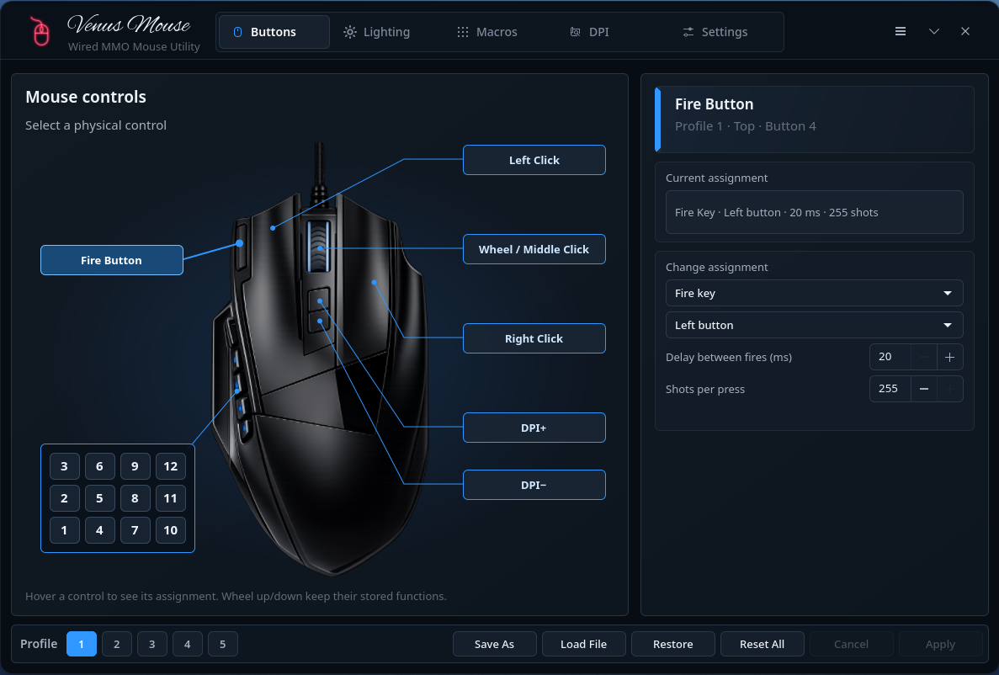
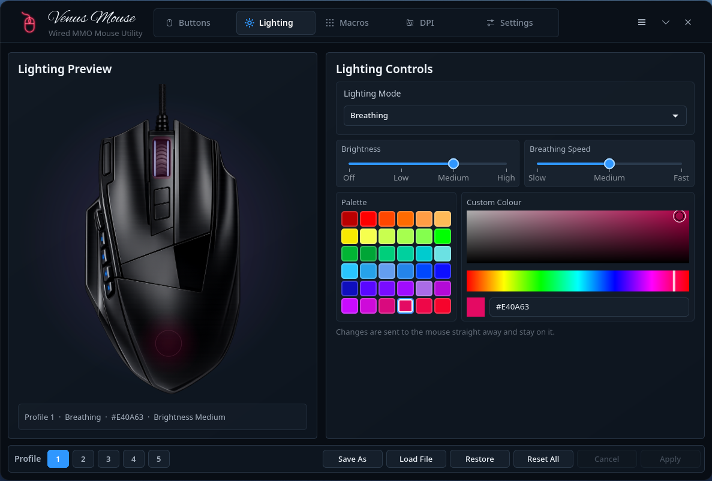
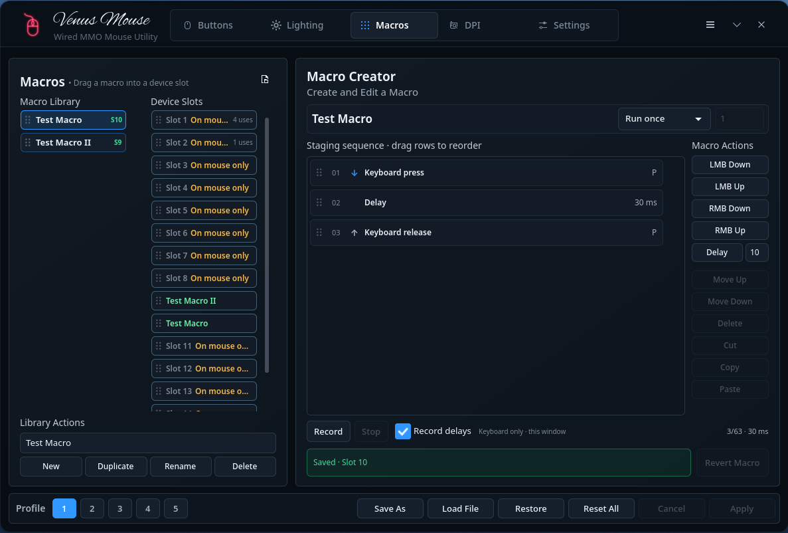
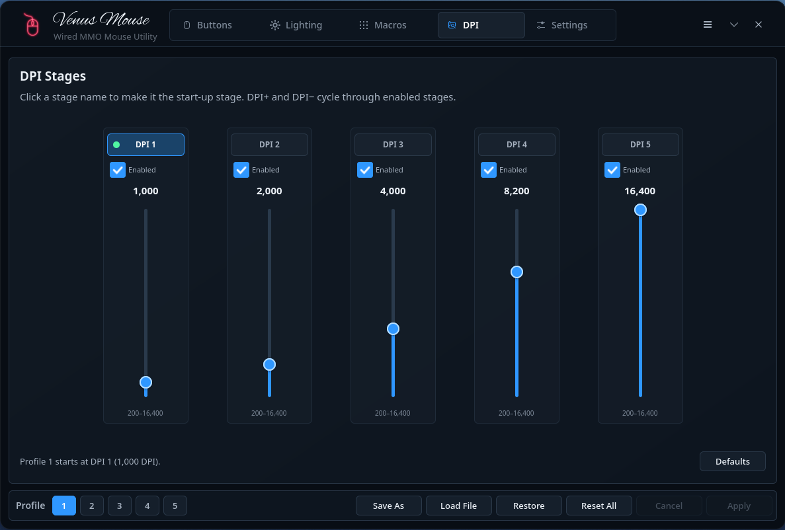
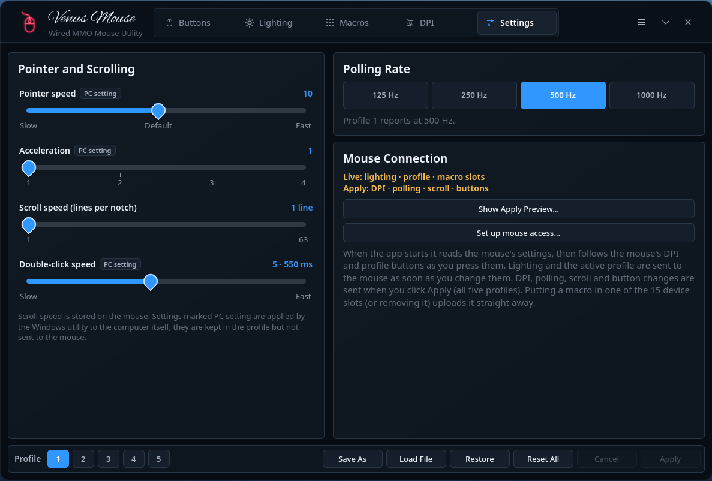

# Venus Mouse — Linux configuration utility

[](https://buymeacoffee.com/berry.dingle)

A native Linux app for the wired **UtechSmart Venus MMO gaming mouse**
(USB `04d9:fc55`), replacing the Windows-only utility. Set up buttons, DPI,
lighting, macros and the five on-mouse profiles from your Linux desktop.

## Screenshots



| Lighting | Macros |
|---|---|
|  |  |
| **DPI** | **Settings** |
|  |  |

## Features

- **Buttons:** assign keys, mouse buttons, macros, DPI and fire keys to all
  18 buttons (the 6 top controls and the 12 side buttons), per profile.
- **DPI:** five stages (200–16,400), each can be switched on or off, plus the
  stage the mouse starts in.
- **Lighting:** six modes, colour, brightness and speed, sent to the mouse as
  you change them.
- **Macros:** record from the keyboard, edit, and drag into any of the 15
  slots on the mouse. Unlimited macro library.
- **Profiles:** all five on-mouse profiles. Switch from the app or with the
  mouse's profile button; save and load profile files.
- **Settings:** polling rate (125–1000 Hz) and scroll speed.
- **Works with Windows files:** imports `.pfd` profiles and `.MSMACRO`/`.MSDB`
  macros from the Windows utility, and exports macros back for Windows.

## Install

Download from the [Releases page](https://github.com/Berry-Dingle/Venus-Mouse-Linux/releases).
Every option needs Python 3.11+, GTK 4.10+ and libadwaita 1.5+, which current
Fedora, Ubuntu 24.04+, Debian 13+ and Arch all have.

| System | Install |
|---|---|
| **Fedora** (44 and later) | `sudo dnf install ./venus-mouse-0.2.1-1.noarch.rpm` |
| **Ubuntu 24.04+ / Debian 13+** | `sudo apt install ./venus-mouse_0.2.1-1_all.deb` |
| **Arch** | `sudo pacman -U venus-mouse-0.2.1-1-any.pkg.tar.zst` (or build it yourself: `cd packaging/arch && makepkg -si`) |
| **Any distribution** | the AppImage: `chmod +x Venus_Mouse-0.2.1-x86_64.AppImage`, then run it |

**After installing a package, unplug and replug the mouse once.** The package
installs a rule that lets your desktop user talk to the mouse, with no root
access needed. Then start **Venus Mouse** from the Utilities menu, or run
`venus-mouse`.

**AppImage:** open *Settings → Set up mouse access…* in the app. It shows one
command to paste into a terminal (it asks for your password once), then
replug the mouse. It needs a systemd-based distribution.

**From source:**

```bash
git clone https://github.com/Berry-Dingle/Venus-Mouse-Linux.git
cd Venus-Mouse-Linux
PYTHONPATH=src python3 -m venus_profile.gui
```

## How it works with the mouse

- **At start-up the app reads the mouse**, and what's on the mouse wins over
  the app's saved copy. *Read from Mouse* in the menu reads it again. Pressing
  DPI± or the profile button on the mouse updates the app as you press.
- **Sent straight away:** lighting, switching profile, and macro slots
  (dragging a macro onto a slot, removing or editing it).
- **Sent when you click Apply** (all five profiles at once): DPI, polling rate,
  scroll speed and button assignments. If you close the app with changes not
  yet applied, it asks whether to *Apply*, *Save*, *Discard* or *Cancel*.
- Everything is stored on the mouse itself, so your settings work on any
  computer, including Windows, without the app running.

### Fire keys

*Shots per press* (1–255) counts every click, including the first. The delay
(20–250 ms) is added on top of the mouse's own ~100 ms per shot. Below 20 ms
the mouse sends only the first click (the same happens in Windows). To see
what a fire key really sends, open the click counter: `venus-mouse
--click-counter` (AppImage: `./Venus_Mouse-0.2.1-x86_64.AppImage
--click-counter`).

## Your files

| What | Where |
|---|---|
| Profiles you save (*Save Profile As…*) | `~/Documents/VenusMouse/Profiles/` |
| Your macro library | `~/Documents/VenusMouse/Macros/` |
| The app's five working profiles (saved automatically) | `~/.local/share/venus-profile/` |

Profiles are `.pfd` files and macros are `.MSMACRO` files, the same formats
the Windows utility uses. To move your setup to another computer, copy the
`~/Documents/VenusMouse` folder. Deleted macros go to the desktop's trash.

To bring files over from the Windows utility, use *Load Profile File…*,
*Import Macro Files…* or *Import Windows MacroDB Folder…* in the menu.
Windows keeps them in `Documents\UtechSmart Venus Gaming Mouse`.

## Using the Windows utility as well

Both programs change the same mouse, but the Windows utility only knows its
own saved files:

- **Recording a macro in Windows uploads it at once**, into the next slot
  Windows thinks is free. It can overwrite macros you put on the mouse from
  Linux.
- **Apply in Windows overwrites everything** on the mouse with its own saved
  settings.
- The fire-key shot count is saved in Linux profiles, but Windows profiles
  have no place for it.

Afterwards, start the Linux app (or use *Read from Mouse*) to see what Windows
left on the mouse. To keep a Linux setup safe, *Save Profile As…* each profile
first, and *Load Profile File…* + Apply afterwards.

## Troubleshooting

- **"The mouse can't be accessed":** replug the mouse after installing. With
  the AppImage, click *How to fix* (or *Settings → Set up mouse access…*)
  first.
- **"No mouse found":** check the cable, then click *Read again*.
- **apt or dnf says a dependency is missing or too old:** the distribution's
  GTK or libadwaita is too old (Debian 12, for example). Use a newer release.
- **To report a problem:** start the app from a terminal with
  `VENUS_PROFILE_DIAGNOSTICS=1 venus-mouse`. It prints one line per change
  sent to the mouse. Please include that output in your
  [issue](https://github.com/Berry-Dingle/Venus-Mouse-Linux/issues).

## Uninstall

`sudo dnf remove venus-mouse`, `sudo apt remove venus-mouse` or
`sudo pacman -R venus-mouse`. Your files in `~/Documents/VenusMouse` and
`~/.local/share/venus-profile` are kept. Delete them if you don't need them.

## For developers

Tests, command-line tools, file formats, the mouse's protocol and how the
packages are built are documented in [docs/DEVELOPER_GUIDE.md](docs/DEVELOPER_GUIDE.md).

## Licence

Venus Mouse is free software: you can redistribute it and/or modify it under
the terms of the GNU General Public License as published by the Free Software
Foundation, either version 3 of the License, or (at your option) any later
version (`GPL-3.0-or-later`; see `LICENSE`). It comes with no warranty.

The bundled title font, Alex Brush, is under the SIL Open Font License 1.1
(`src/venus_profile/gui/data/fonts/AlexBrush-OFL.txt`). UtechSmart and Venus
are names of their respective owner; this project is not affiliated with or
endorsed by UtechSmart.
